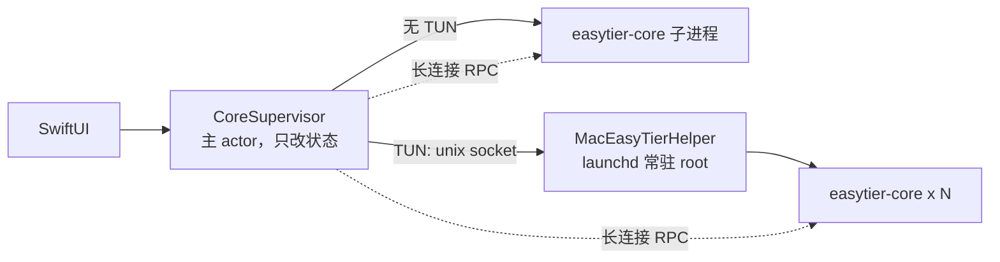
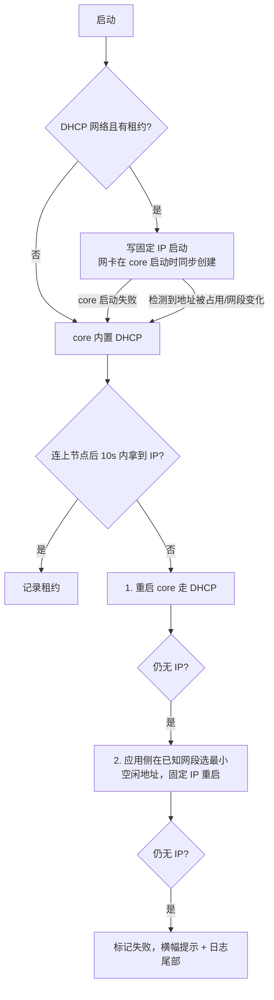

# VPN 核心与 Mac 应用对接方案 v2

## 1. 要解决的问题

| 现象 | 实测根因 |
| --- | --- |
| TUN 网络“不会自动获取 IP” | 现场抓到的 TUN core 已连上 3 个节点 17 分钟，`node` 里 `Virtual IP` 为空；`utun` 已创建（MTU 1360）却仍是 rust-tun 的默认 `10.0.0.1`，没有 `10.144.144.x`。core 日志里没有任何 `run shell cmd` / `dhcp ip changed`，进程表里有两个 `<defunct>` 子进程：core 在 DHCP 之后创建网卡、再用 `ifconfig` 配 MTU/IP 的链路卡住了，且**应用侧对此毫无感知**（一直显示“未分配”）。同一份配置在干净环境里 2 秒内就能拿到 IP，所以是“链路偶发卡死 + 无人兜底”。 |
| 启动慢 | 每次 TUN 启动都要经 `AuthorizationExecuteWithPrivileges` 弹管理员授权（授权缓存只有几分钟），再 `sh -c exec helper` → fork core；启动前先起一个 `--check-config` 子进程；每次轮询新建 4 个 TCP 连接；`readLogs`、memory 查询（阻塞 socket）都在主 actor。 |
| 停止慢 | 停止先写 stop 文件/连 socket，再 `isAlive` 轮询 pid 文件（100ms 粒度，pid 文件被删后还有“启动 10 秒宽限”的误判），最坏要等 1 秒才补 `SIGKILL`。 |
| 日志噪声 | 每次轮询新建连接，core 日志每 2 秒刷几十行 `rpc server`/`read aborted`（17 分钟 3.8 MB）。 |

core 本身很快（实测：RPC 就绪 56ms、`SIGTERM` 退出 10ms、DHCP 约 2s），慢全在对接层。

## 2. 新架构

### 2.1 常驻 root 守护进程（取代 AEWP + 每网络 helper）

- 一次管理员授权安装：把 helper 与 core 复制到 `/Library/PrivilegedHelperTools/com.maceasytier.helper/`（root 所有，安装时校验 SHA-256），写 `/Library/LaunchDaemons/com.maceasytier.helper.plist` 并 `launchctl bootstrap`。不依赖开发者证书/SMAppService（当前是 ad-hoc 签名）。
- 之后 TUN 的启动/停止都是一次本地 Unix socket 往返，**不再弹密码**。
- 协议（TAB 分隔单行）：`PING` / `START` / `STOP` / `STOPALL` / `STATUS`。`STOP` 在 core **真正退出后**才应答，App 不再轮询；`START` 用 CLOEXEC 管道回传 exec 失败，几乎零延迟。
- 安全：socket 在 `/var/run`，用 `getpeereid` 只放行安装者 uid；core 路径固定为安装目录里的 root 副本；配置文件必须是调用者自己的、非符号链接、他人不可写的普通文件；日志以 `O_NOFOLLOW` 打开；参数白名单。
- 生命周期：`START` 带 owner pid，App 退出/崩溃后守护进程自动结束对应 core；守护进程被卸载/关机时结束所有 core（core 与守护进程同进程组，launchd 兜底）。
- 版本：安装时把 helper+core 的哈希作为 `--tag`；App 比对，不一致就提示“需要更新”。

### 2.2 App 侧

- `PrivilegedHelper`：socket 客户端 + 安装/卸载（都在后台线程）。
- `EasyTierRPC.Session`：每个 core 一条长连接，实例 UUID 只解析一次；失败自动重连。
- `CoreSupervisor`：
  - 启动路径不再跑 `--check-config`（进程内 `TOMLCodec.validate`；core 自己启动时再校验，错误从日志回显）。
  - 用户进程用 20ms 粒度等待退出；守护进程路径无轮询。
  - 轮询在后台并发拉取各 core 快照；启动/等 IP 时 0.5s，稳定后 2s。
  - 日志增量读取（单次 ≤512KB），清空日志改为原地截断（core 以 `O_APPEND` 写）。

### 2.3 虚拟 IP：租约 + 看门狗

- 租约保存在 `NetworkProfile.leasedIPv4`；编辑器保存不会覆盖它，网络名/节点/DHCP 开关变化才作废。
- 好处：重启不再漂移地址；IP 在启动瞬间就位（实测 0.00s，对比 DHCP 约 2.2s）；core 内置 DHCP 链路卡住时也不会卡死用户。
- 冲突检测忽略同主机名的路由（重启后其他节点上可能短暂残留“旧的自己”）。
- 界面区分“等待节点… / 获取中… / 未分配（已失败）”。

## 3. 实测结果（真实 TUN，同一网络）

| 指标 | 旧方案（按代码与现场日志推断，未做对照实测） | 新方案（实测） |
| --- | --- | --- |
| TUN 启动 | 每次授权弹窗（缓存几分钟）+ 启动链路 | 0.58s（`start` 返回，状态为运行中） |
| 拿到 IP | 本次现场 17 分钟仍为空 | 首次 DHCP ≈2.2s；有租约时 0.00s |
| 停止 | 最坏 ≈1s+（轮询/补杀） | 0.08–0.11s |
| 首次安装 | — | 一次密码（约 10s，含输入） |

复现方式：`Scripts/test-helper.sh`（守护进程协议，无需 root），`CoreIntegrationTests`（真实安装+TUN，默认跳过，见文件头）。

## 4. 迁移与回退

- 旧版本遗留的 root core（异常退出时）会占用 `11010` 端口，设置 → 核心 →“清理”一次授权即可结束。
- 卸载：设置 → 核心 →“卸载”，或手动 `sudo launchctl bootout system/com.maceasytier.helper && sudo rm -rf /Library/PrivilegedHelperTools/com.maceasytier.helper /Library/LaunchDaemons/com.maceasytier.helper.plist`。
- 无 TUN 网络不依赖守护进程，行为与之前一致。

## 5. 已知限制 / 后续

- 现场那次“DHCP 之后建网卡链路卡死”的 core 内部原因未能在干净环境复现（用 `osascript` 授权链与 `launchd` 两种方式启动均 4 秒内拿到 IP）。新方案不依赖它不出问题，而是用租约绕开、用看门狗兜底；若再出现，请保留 `core.log` 与 `ps` 里的 `<defunct>` 子进程信息。
- 有 Developer ID 后可改用 `SMAppService.daemon` + XPC，把“手写 plist + osascript 授权”替换为系统原生授权流程，协议层不变。
