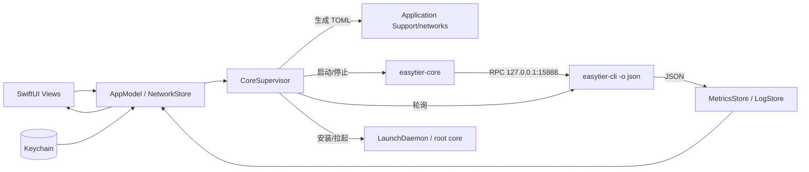

# EasyTier macOS 客户端功能规划

## 1. 背景与目标

现有工程是 v2mac（Xray 客户端）的 SwiftUI 外壳：侧边栏分组 + 网络列表 + Inspector + 连接条 + 日志/连接/规则窗口 + 设置页。数据全部是占位数据，配置、核心、进程、签名都还没有接入。

目标：保留现有布局与交互骨架，把语义整体切换为 **EasyTier 网络管理器**：

- 管理多个 EasyTier 网络配置（network profile），可单独/全部启动。
- 启动内置 `easytier-core`，读取节点、对等节点、路由、流量与日志。
- 覆盖 EasyTier 的核心能力：TUN/无 TUN、子网代理、出口节点、SOCKS5、端口转发、WireGuard 门户、ACL、加密与 P2P 调优。
- 保持菜单栏常驻，支持开机启动、自动连接。
- 复用现有 `Scripts/build.sh` / `Scripts/package.sh`，把 core 二进制纳入构建与签名。

成功标准：

1. 新建/导入一个网络配置后能启动 core，看到本节点、peer、route，能正常停止。
2. TUN 模式能通过管理员授权运行；无 TUN 模式在普通用户下可用。
3. 高级服务（SOCKS5、子网代理、端口转发、WireGuard 门户）可在 UI 中配置并生效。
4. 构建、打包、签名流程继续通过。

## 当前实现状态

- 已完成：网络配置 CRUD、TOML 导入/导出/校验、Keychain、每网络独立 core 进程、无 TUN 运行、TUN 授权启动（root helper + Unix socket）、原生 RPC（ZCPacket + protobuf，不依赖 easytier-cli）、node/peer/route/traffic 轮询、日志窗口、Peers/Routes 窗口、菜单栏、登录启动、设置页、构建脚本嵌入与签名、TOML 单元测试。
- 未完成：SMAppService LaunchDaemon、通知、WireGuard 门户、ACL、系统 DNS、凭据管理、Core 更新、utun 接口流量计数器。

## 2. 非目标（从现有 UI 删除的 Xray 概念）

| 现有元素 | 处理 |
| --- | --- |
| 订阅 URL / 订阅更新 | 删除。改为 TOML 导入导出、网络配置来源 |
| 节点类型 `vless/vmess/trojan`、分享链接、QR | 删除。改为 EasyTier 网络加入信息（网络名/密钥/对等节点） |
| 按应用/域名的 Proxy/Direct/Block 规则 | 删除。EasyTier 没有应用级规则；改为路由表、子网代理、ACL |
| 系统代理、Kill Switch、WARP、Sandbox、区域包 | 删除 |
| 单节点延迟测试 | 删除。延迟来自 `easytier-cli peer` 的实时连接统计 |
| 多协议节点地址 | 删除。改为虚拟 IP、peer URL、listener URL |

## 3. EasyTier 能力与 UI 落点

| EasyTier 能力 | 配置/命令 | UI 入口 |
| --- | --- | --- |
| 网络身份 | `network_name`、`network_secret` | 网络编辑器 |
| 虚拟地址 | `dhcp`、`ipv4`、`ipv6`、`hostname` | 网络编辑器 |
| 组网方式 | `peers`、`external_node`、`listeners`、`no_listener` | 网络编辑器（公共节点/手动/独立监听） |
| 子网代理 | `proxy_network`（CIDR、映射、allow）、`proxy_forward_by_system` | 路由设置 |
| 出口节点 | `enable_exit_node`、`exit_nodes` | 连接条菜单 + 路由设置 |
| SOCKS5 | `--socks5 <port>` | 连接条 + 服务设置 |
| 端口转发 | `--port-forward` / PatchConfig | 服务设置（规则表） |
| WireGuard 门户 | `vpn_portal_config` + clients | 服务设置 |
| ACL / 端口白名单 | `acl`、`tcp_whitelist`、`udp_whitelist` | 路由/ACL 窗口（P2） |
| 魔法 DNS | `accept_dns`、`tld_dns_zone`、`dns` | 高级设置（P2） |
| Secure Mode / 临时凭据 | `secure_mode`、密钥、`credential` | 高级设置（P2） |
| P2P / KCP / QUIC / 加密 / MTU | 各类 flags | 高级设置 |
| 节点与连接统计 | `easytier-cli node/peer/route/stats` | 主窗口 + Peers/Routes 窗口 |
| 日志 | `--console-log-level`、`--file-log-*`、`logger` | 日志窗口 + Core 设置 |
| 系统服务 | launchd / `easytier-cli service` | Core 设置 |

## 4. 现有 UI 改造映射

| 现有文件/元素 | 改造 | 新用途 |
| --- | --- | --- |
| `Shared/Models.swift` 的 `ServerGroup/ServerProfile` | 替换 | `NetworkGroup/NetworkProfile` |
| `App/State/AppModel.swift` | 重写状态层 | 配置存储 + 运行时状态 + 选择 |
| `SidebarView` 的 All/Favorites/Subscriptions/Disabled/Recent | 保留结构改文案 | 全部网络/收藏/分组/禁用/最近连接 |
| `SidebarTools` 的 Connections/Rules | 改名 | Peers / Routes 窗口入口 |
| `ServerListView` 表格列 Name/Type/Address/Delay | 重定义 | 网络名/状态/网络名/虚拟 IP/Peers/流量 |
| `InspectorView` | 重做 | 所选网络的节点信息、peer 统计、监听器、快捷操作 |
| `ConnectionBar` | 重做 | 启停、状态、TUN/无 TUN、SOCKS5 地址、出口策略、流量 |
| `ConnectionsWindow` | 重写 | `PeersWindow`：peer 表 + 连接详情 |
| `RulesWindow` | 重写 | `RoutesWindow`：路由表、子网代理、出口节点；ACL 后续加入 |
| `LogView` | 接真实日志 | 按网络切换、级别过滤、跟随、复制/清空 |
| `AddSubscriptionSheet` | 替换 | `NetworkEditor`（表单 + TOML 高级编辑） |
| `RegionPacksView` | 删除 | — |
| Settings Tab | 精简重排 | General / Network / Routing / Services / Advanced / Notifications / Core / About |
| `MacEasyTierApp` | 增加 `MenuBarExtra` | 状态图标、快速启停、窗口入口、退出 |
| App Commands | 调整 | 新建网络、启停、Peers/Routes/Logs、设置 |

### 设置页重排

| 新 Tab | 内容 |
| --- | --- |
| General | 登录启动、自动连接、菜单栏显示、通知、语言、更新 |
| Network | 默认监听器、RPC 端口、hostname、DHCP、TUN/无 TUN、MTU、设备名 |
| Routing | 延迟优先、出口节点、手动路由、子网代理、系统转发 |
| Services | SOCKS5、端口转发、WireGuard 门户、魔法 DNS、ACL |
| Advanced | P2P/打洞、KCP/QUIC 代理、压缩、加密、Secure Mode、线程、STUN |
| Notifications | 连接/断开/错误通知开关 |
| Core | 内置版本/路径、服务模式、日志级别、重启、更新 |
| About | 版本、许可（EasyTier LGPL-3.0）、项目链接 |

## 5. 功能清单

### P0：可用闭环（MVP）

1. **网络配置 CRUD**
   - 新建、编辑、复制、删除、启用/禁用、收藏、分组。
   - 字段：名称、`instance_name`、`network_name`、`network_secret`、组网方式、`peers`、`listeners`、`dhcp`/`virtual_ipv4`、`hostname`、TUN 开关。
   - 校验：CIDR、URL、端口、网络名冲突、重复虚拟 IP 提醒。
2. **TOML 导入/导出**
   - 导入 `.toml` 生成配置；导出当前配置。
   - 保存前用 `easytier-core --check-config -c <file>` 校验；展示解析错误。
3. **Core 生命周期**
   - 定位并启动内置 `easytier-core`；生成配置目录。
   - 状态机：`stopped → starting → running → stopping → stopped`，失败记录错误。
   - 退出清理、异常退出检测、可选自动重启。
4. **无 TUN 模式**
   - 普通用户直接运行 core，`--no-tun`，用于无权限环境。
5. **运行时数据**
   - 本节点：虚拟 IP、hostname、peer ID、listeners、NAT 类型、版本、代理 CIDR。
   - Peers：hostname、虚拟 IP、延迟、丢包、RX/TX、隧道协议、NAT、P2P/中继、版本。
   - Routes：目标、proxy CIDR、下一跳、cost、路径延迟。
   - 轮询 1–2 秒；窗口隐藏时降低频率。
6. **主界面**
   - 网络列表、Inspector、连接条接通真实状态。
   - 双击启动/停止网络；右键菜单编辑/复制/导出/删除。
7. **日志**
   - core stdout/stderr 或文件日志采集；级别、关键字过滤；跟随、复制、清空、打开日志目录。
8. **持久化与密钥**
   - 配置存 Application Support；`network_secret` 存 Keychain。
9. **菜单栏**
   - 状态图标（关闭/连接中/运行/错误）；每个网络启停；打开主窗口/Peers/Routes/Logs/设置；退出。
10. **构建集成**
    - 下载/固定 core 版本；嵌入 `Contents/Helpers/easytier-core` 与 `easytier-cli`；签名顺序先 helper 后 App。

### P1：完整网络能力

11. **TUN 权限与服务**
    - 方案：SMAppService LaunchDaemon（推荐）或授权启动 root core；安装/卸载/状态/重启。
    - 登录启动、自动连接、崩溃恢复。
12. **流量统计**
    - 虚拟 IP 匹配 `utunN`，读取 `getifaddrs`/`if_data` 计数器，计算速率；回退到 peer 字节数。
13. **连接条能力**
    - TUN/无 TUN 切换、SOCKS5 开关与地址复制、出口节点菜单。
14. **子网代理与路由**
    - `proxy_network` 增删、CIDR 映射、allow 列表；`manual_routes`；`proxy_forward_by_system`。
15. **出口节点**
    - 本机是否可作为出口；按优先级选择出口节点列表。
16. **端口转发**
    - 规则表：协议、bind、dst；增删改、冲突校验、运行时应用（PatchConfig 或重启实例）。
17. **WireGuard 门户**
    - 启用、监听地址、私钥（Keychain）、客户端增删（名称/虚拟 IP/ACL 组）。
18. **通知**
    - 网络连接/断开、core 崩溃、证书/配置错误。
19. **高级网络选项**
    - 延迟优先、禁用 P2P、lazy/need P2P、TCP/UDP/对称 NAT 打洞开关、KCP/QUIC 代理、压缩、加密算法、MTU、多线程、绑定网卡、STUN 服务器。

### P2：进阶与运维

20. **ACL**
    - 查看规则命中统计；TOML 编辑并运行时替换；TCP/UDP 端口白名单。
21. **魔法 DNS**
    - 启用、TLD zone、记录查看；macOS 系统 DNS 应用与恢复（失败回滚）。
22. **Secure Mode 与临时凭据**
    - Secure Mode 开关、本地密钥管理；凭据生成/撤销/列表（TTL、组、代理白名单）。
23. **共享节点/中继**
    - 中继网络白名单、`relay_all_peer_rpc`、私有模式、出口带宽限制。
24. **Core 运维**
    - 版本检测、从 GitHub Releases 更新、校验和、CLI 工具安装。
25. **远程配置**
    - `--config-server` / Web 控制台托管配置（可选）。
26. **体验**
    - 中英文本地化、键盘快捷键、无障碍、深色/玻璃样式统一。

## 6. 数据模型

```swift
struct NetworkProfile: Identifiable, Codable, Hashable {
    var id: UUID
    var name: String              // UI 显示名
    var groupID: UUID?
    var isFavorite: Bool
    var isDisabled: Bool
    var autoConnect: Bool
    var tunEnabled: Bool
    var config: NetworkConfig
}

struct NetworkConfig: Codable, Hashable {
    var instanceName: String
    var networkName: String
    var networkSecretRef: String  // Keychain key；TOML 导出时再取明文
    var hostname: String
    var dhcp: Bool
    var virtualIPv4: String?
    var virtualIPv6: String?
    var peers: [String]
    var externalNode: String?
    var listeners: [String]
    var noListener: Bool
    var proxyNetworks: [ProxyNetwork]
    var manualRoutes: [String]
    var exitNodes: [String]
    var enableExitNode: Bool
    var socks5Port: Int?
    var portForwards: [PortForwardRule]
    var vpnPortal: VPNPortalConfig?
    var advanced: AdvancedConfig
}

struct AdvancedConfig: Codable, Hashable {
    var latencyFirst: Bool
    var disableP2P: Bool
    var lazyP2P: Bool
    var needP2P: Bool
    var disableTCPHolePunching: Bool
    var disableUDPHolePunching: Bool
    var disableSymHolePunching: Bool
    var enableKCPProxy: Bool
    var disableKCPInput: Bool
    var enableQUICProxy: Bool
    var disableQUICInput: Bool
    var compression: String       // none/zstd
    var encryptionAlgorithm: String
    var disableEncryption: Bool
    var multiThread: Bool
    var bindDevice: String?
    var stunServers: [String]
    var relayNetworkWhitelist: [String]
    var relayAllPeerRPC: Bool
    var privateMode: Bool
    var secureMode: Bool
    var mtu: Int?
    var devName: String?
}
```

运行时只读模型：

```swift
struct CoreState { var status: Status; var pid: Int32?; var error: String? }

struct NodeInfo {
    var virtualIPv4: String
    var hostname: String
    var peerID: UInt32
    var listeners: [String]
    var publicIP: String?
    var natType: String
    var version: String
    var proxyCIDRs: [String]
}

struct PeerRow: Identifiable {
    var id: UInt32
    var hostname: String
    var virtualIPv4: String
    var latencyMs: Double?
    var lossRate: Double
    var rxBytes: UInt64
    var txBytes: UInt64
    var tunnelProtocols: [String]
    var natType: String
    var isP2P: Bool
    var version: String
}

struct RouteRow: Identifiable {
    var id: UInt32
    var hostname: String
    var virtualIPv4: String
    var proxyCIDRs: [String]
    var nextHop: String
    var cost: Int
    var pathLatency: Int
    var isDirect: Bool
}
```

## 7. 运行时架构



关键决定：

1. **进程模式优先，不采用 FFI**
   - 内置官方 `easytier-core` + `easytier-cli`，避免在 Xcode 中集成 Rust 构建与静态库签名。
   - TUN 只需 core 以 root 运行，GUI 保持普通用户；FFI 方案则要求整个 App 以 root 重启（此前已验证，但 UX 与签名成本更高）。
2. **数据读取先用 `easytier-cli -o json`**
   - 支持 `peer`、`route`、`node`、`stats`、`port-forward`、`vpn-portal`、`acl`、`logger`。
   - 每个 network profile 固定 `instance_id`，查询时带 `-i`，避免多实例结果包裹。
   - 轮询 1–2 秒；后续如需事件推送再评估原生 RPC（protobuf）。
3. **每个 network profile 一个 core 进程**
   - 当前实现为每网络独立进程、独立 RPC 端口，启动/停止/失败隔离最简单。
   - 后续如需要减少进程数，可切换为单 core `--config-dir` + instance 选择；接口层已通过 `instance` 隔离，CLI 查询可平滑迁移。
4. **权限**
   - 首选 SMAppService 安装 LaunchDaemon（macOS 13+）：root core、登录自启、崩溃重启。
   - 备选 AuthorizationExecuteWithPrivileges 启动一次 root core（EasyTier 官方 GUI 的做法，API 已废弃但可用）。
   - 无权限用户走 `--no-tun`。
5. **配置写入**
   - GUI 写用户目录 `~/Library/Application Support/MacEasyTier/networks/*.toml`，权限 0600。
   - daemon 以 root 读取同一目录；避免 GUI 需要 root 写配置。
   - `network_secret` 仅落 Keychain；生成 TOML 时写入临时文件供 core 读取，启动后清理（或使用 root 可读的受控目录）。

## 8. 实施阶段

### M1：配置与本地核心（无 TUN）

- 文件：`Shared/Models.swift`、`App/State/AppModel.swift`、新增 `App/Core/{NetworkStore,CoreSupervisor,TOMLCodec,CLIBridge,LogStore}.swift`、`App/Features/ServerList/ServerListView.swift`、`InspectorView.swift`、`ConnectionBar.swift`。
- 逻辑：配置 CRUD + TOML + 启动/停止 core（用户权限、`--no-tun`）+ 日志。
- 验证：新建配置 → 启动 → `easytier-cli node` 有输出 → 停止；TOML 往返一致；错误配置有明确报错。

### M2：监控与窗口

- 文件：`ConnectionsWindow.swift` → `PeersWindow`、`RulesWindow.swift` → `RoutesWindow`、`LogView.swift`、`MacEasyTierApp.swift`（MenuBarExtra）。
- 逻辑：CLI JSON 解码、peer/route 表格、流量采样、菜单栏状态。
- 验证：本机启动两个 profile（不同网络名）→ 两个实例可切换；peer/route 数据正确；菜单栏启停生效。

### M3：TUN 与系统集成

- 文件：新增 `App/Core/PrivilegedService.swift`、launchd plist 资源、`project.yml`、`Scripts/build.sh`。
- 逻辑：SMAppService 安装/卸载/状态；root core 启动；登录启动；自动连接；崩溃恢复。
- 验证：普通用户启动 TUN 网络 → utun 出现、`ping` 虚拟网可达；退出/重启 App 后服务状态正确；签名校验通过。

### M4：网络服务

- 文件：`SettingsView.swift` 新增 Services Tab；新增 `PortForwardEditor`、`VPNPortalEditor`、`Socks5Section`。
- 逻辑：SOCKS5、子网代理、出口节点、端口转发、WireGuard 门户；运行时应用与重启兜底。
- 验证：本地 SOCKS5 可代理到虚拟网；端口转发 tcp/udp 各一条可用；WireGuard 客户端配置生成。

### M5：安全与进阶

- 文件：`AclEditor`、`MagicDNSSection`、`CredentialSection`、`AdvancedSettings`。
- 逻辑：ACL 统计/替换、白名单、魔法 DNS、Secure Mode、临时凭据、P2P 调优、core 更新。
- 验证：ACL 生效/回滚；DNS 应用后可解析 `<hostname>.et.net`；凭据生成/撤销。

## 9. 测试策略

- 单元：TOML 编解码往返、CIDR/URL 校验、CLI JSON 解码（真实输出固件）、状态机、流量速率计算。
- 集成：本地无 TUN 启动 core，校验 node/peer/route/停止；两个实例并行；异常退出重启。
- 手工：TUN 权限、utun 计数器、SOCKS5、端口转发、WireGuard 门户、菜单栏、登录启动。
- 回归：`Scripts/build.sh`、`Scripts/package.sh`、DMG 挂载与签名。

## 10. 风险与待确认

| 风险 | 影响 | 缓解 |
| --- | --- | --- |
| TUN 需要 root | 普通启动失败 | 无 TUN 模式兜底；SMAppService daemon；清晰的授权引导 |
| 多实例单进程失败隔离 | 一个网络配置错误拖垮全部 | 启动前 `--check-config`；失败回退为每网络独立进程 |
| CLI JSON 结构随版本变化 | 解析失败 | 固定 core 版本；解码器做字段可选与降级；固件测试 |
| 轮询开销 | CPU/进程频繁拉起 | 1–2 秒轮询；窗口不可见降频；批量一次查询多实例 |
| 配置/密钥落盘 | 泄露网络密钥 | Keychain 存储；TOML 0600；临时文件及时清理 |
| 分发二进制 | LGPL-3.0 合规、签名/公证 | 保留 LICENSE 与源码链接；先签 helper 再签 App；公证 |
| `AuthorizationExecuteWithPrivileges` 已废弃 | 未来系统可能移除 | 以 SMAppService 为目标方案，授权启动仅作过渡 |
| macOS 网络权限/防火墙 | 子网代理、监听不可用 | 首次运行引导放行；诊断页展示监听与防火墙状态 |
